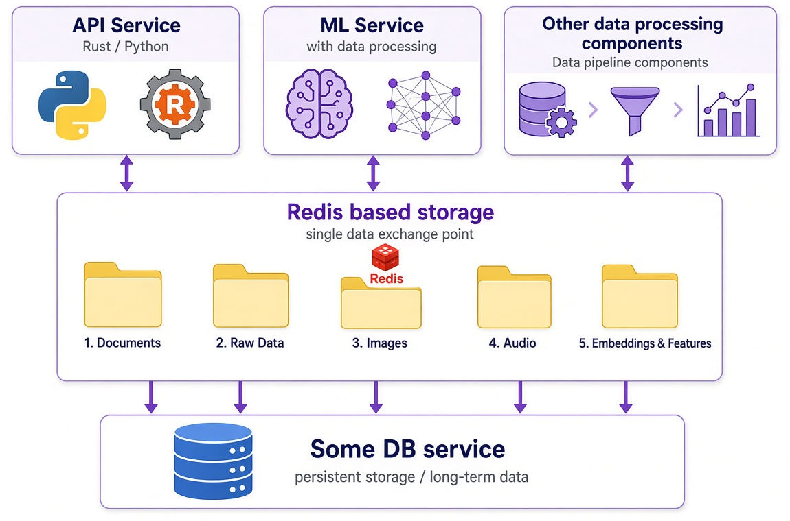

# datatraffic - encrypted file exchange between data-processing components via Redis

`datatraffic` is a Rust library (`libdatatraffic`) that exchanges byte streams - presented as named files with an optional note - between independent processes over Redis pub/sub, with AES-256-GCM encryption of the payload. It ships with a Rust test client/server (`hubdatatraffic`) and a Python package (`pydatatraffic`) wrapping the same library through its C ABI (ctypes).

The goal: give data-processing components a simple encrypted channel for passing binary artifacts between pipeline stages, without each component knowing about Redis or encryption.



## Features

- **Redis pub/sub transport** - publish/subscribe on per-project topics (`dt:<project>`); any client sends to any project it knows the name of.
- **AES-256-GCM encryption** - name, note and content travel in an authenticated ciphertext; random padding (8–32 bytes) hides the plaintext length. Only sender identity stays clear so clients can filter out their own messages cheaply.
- **Inbox / outbox channels** - two async channels: `outbox` sends `(project, DataFile)` pairs with the target chosen per message, `inbox` receives them tagged with the source project; all Redis mechanics are hidden behind one `TrafficClient`.
- **Presence & configuration** - clients register in a per-project SET so peers see who is active; settings come from environment (`REDIS_URL`, `CRYPTO_KEY`, `CLIENT_NAME`, `REDIS_PASSWORD`) with CLI overrides that always win.
- **Python bindings** - sync and asyncio clients plus a CLI mirroring the Rust one; installable as a wheel/sdist with an architecture-tagged shared library.

## Use case: ML/DL data pipelines

In ML/DL projects, processing is split into stages (ingest → preprocess → train/serve) that often run in separate processes or on different machines. These stages need to hand off large binary artifacts - **audio clips, images, text blobs** - without a shared filesystem and with the payload protected in transit.

`datatraffic` provides exactly that: each stage is a client that subscribes to project topics (the "queues" it consumes from) and publishes to the next stage's topic. A file sent by one component arrives, decrypted, at every other subscribed component - an audio encoder can push clips to a training consumer, or an image preprocessor can feed a model server, all over Redis with AES-256-GCM in between.

## Components / architecture

| Component | Type | Purpose |
| --------- | ---- | ------- |
| `libdatatraffic` | Rust library (`rlib` + `cdylib`) | Core: Redis pub/sub transport, AES-256-GCM message codec, presence, inbox/outbox channels, and the C ABI for Python. |
| `hubdatatraffic` | Rust binary (clap CLI) | Demo/test client+server that exercises the full pipeline end-to-end. |
| `pydatatraffic` | Python package | ctypes bindings over the library's C ABI: sync + asyncio clients and a click CLI mirroring `hubdatatraffic`. |
| `rust_api` | Self-contained Rust module | Safe wrapper over the C ABI for external Rust projects that link against the prebuilt `.so`; installed by `scripts/install_rust.sh`. |

### `libdatatraffic` (core)

- `transport.rs` - `DataFile { name, note, data }`, the unit of exchange.
- `data.rs` - message codec: `RawData` (plaintext wire layout + random padding) and `ClientData` (AES-256-GCM envelope), plus `DataError`.
- `redis_client.rs` - topic naming, encrypted wire encode/decode, presence, and the public `TrafficClient` handle.
- `settings.rs` / `config.rs` - settings resolution (explicit > env > default), key generation/decoding, Redis-password URL helper.
- `ffi.rs` - C ABI (`ffi_client_new/send/recv/free`, …) on a global tokio runtime for the Python bindings.

### `hubdatatraffic` (Rust CLI)

A single binary with two modes: **server** (`--listen <projects…> [--out-dir]`) subscribes to project topics and saves received files; **client** (`--send-file <path> --project <name> [--msg]`) reads a file, encrypts it and publishes it. `--genkey` prints a fresh 32-byte key in hex.

### `pydatatraffic` (Python package)

- `_lib.py` - ctypes bindings: sync `Client`, `ReceivedFile`, `FFIError`, and shared-library discovery with an architecture-tagged filename (`libdatatraffic.so.1.<arch>`).
- `api.py` - `AsyncClient`, a non-blocking asyncio wrapper (background send/recv loops + queues, context manager).
- `main.py` - click CLI mirroring `hubdatatraffic`.

Packaging lives at the repo root (`pyproject.toml`, `setup.py`, `MANIFEST.in`): a PEP 517 build that compiles `libdatatraffic` via cargo and bundles the architecture-tagged `.so` into the wheel/sdist.

### `rust_api` (Rust bindings)

- `datatraffic.rs` - self-contained module with no external dependencies: declares the C ABI of `libdatatraffic.so` and wraps it in a small safe interface (`Client`, `Config`, `DataFile`, `FfiError`). Installed into consumer projects by `scripts/install_rust.sh`; see [Using libdatatraffic from Rust](#using-libdatatraffic-from-rust).

## How it works

### Message flow

```text
sender process                          Redis                  receiver process
    |                                       |                          |
    | outbox.send((project, DataFile))      |                          |
    |--- encrypt (AES-256-GCM) ------------>|                          |
    |    publish dt:<project>  [sender][blob]------------------------->| inbox.recv() -> (project, DataFile)
```

A sender pushes a `(project, DataFile)` pair into its outbox - target chosen per send; a background task encrypts it and publishes the envelope to that project's topic. Every other subscribed client drops messages from itself (by sender name), decrypts the rest and hands them to its inbox tagged with the source project taken from the channel name.

### Wire format

The on-wire payload is an encrypted envelope:

```text
[sender_len u32le][sender_utf8][ClientData blob]
```

- `sender` stays in the clear so a client can filter out its own messages without decrypting.
- The `ClientData` blob is `[encrypted][nonce][4B u32le len(encrypted)]`, where `encrypted` is the AES-256-GCM ciphertext (with auth tag) of the plaintext message and `nonce` is a fresh random 12-byte nonce per message.

The plaintext inside the ciphertext is:

```text
[1B name_len][2B u16le note_len][1B random_len][name][note][random][data]
```

`random` is an 8–32 byte padding block that hides the length of `data`. Field widths bound the lengths (name ≤ 255, note ≤ 65535).

### Encryption model

- Cipher: **AES-256-GCM** with a 32-byte key (`CRYPTO_KEY`, hex) and a random 12-byte nonce per message.
- The name, note and data are encrypted together; the GCM auth tag detects tampering or a wrong key (a valid structure that fails to decrypt is reported as `BadPayload`).

### Presence & discovery

On start a client registers its name in each watched project's Redis SET (`dt:__presence__:<project>`), subscribes to the global presence topic, and refreshes the active-client list every 30 s. On shutdown it removes itself best-effort. This lets peers see which clients are currently active on a project.

## Requirements

- Rust toolchain (stable) for `libdatatraffic` / `hubdatatraffic`.
- Python ≥ 3.10 with a virtualenv (`venv/`) for the Python package and tests.
- A reachable Redis instance (local or Docker). Default URL is `redis://localhost:6379`; set `REDIS_PASSWORD` if your Redis requires authentication.

## Building and running

### Running the example

Below is how to send a file from `examples` in one process and receive it in another.

#### 1. Start Redis

Locally:

```bash
redis-server
```

Or via Docker, if you have a compose file:

```bash
docker compose up -d redis
```

By default `redis://localhost:6379` is used. If your Redis has a password set - pass it via `REDIS_PASSWORD` (or the `--password` flag).

#### 2. Generate an encryption key

```bash
cargo run -p hubdatatraffic -- --genkey
# -> 64 hex characters, e.g.: 3f9a1c...e0b7
```

Save the result - the same key is needed by both the server and the client.

#### 3. Set up the environment

In both terminals:

```bash
export REDIS_URL=redis://localhost:6379
export CRYPTO_KEY=<key from --genkey>
# export REDIS_PASSWORD=<Redis password, if any>
```

#### 4. Start the server (receive) - terminal 1

```bash
cargo run -p hubdatatraffic -- --listen demo --out-dir ./received
```

The server subscribes to project `demo` and saves received files into `./received/`.

#### 5. Start the client (send) - terminal 2

```bash
cargo run -p hubdatatraffic -- --send-file examples/data.txt --project demo --msg "hello"
```

The client reads the file, encrypts it, and publishes to project `demo`.

#### 6. Verify the result

In the server terminal a log line about receiving the file will appear, and the file itself is saved to disk:

```bash
ls ./received/
# -> data.txt
diff examples/data.txt ./received/data.txt && echo "OK: files match"
```

The `data.txt` in `./received/` must be byte-for-byte identical to the original `examples/data.txt`.

### Python package (`pydatatraffic`)

`libdatatraffic` is also exposed to Python through a ctypes wrapper in the
`pydatatraffic/` package, with a CLI that mirrors `hubdatatraffic`.

#### Building the shared library

The loader looks for an architecture-tagged `libdatatraffic.so.1.<arch>` next to the package, in the current directory, standard system paths (`/usr/local/lib`, `/usr/lib`) and `$LD_LIBRARY_PATH`; set `LIBDATATRAFFIC_LIB` to force a specific file. Build the cdylib and install it next to the package:

```bash
make build-lib # cargo build -p libdatatraffic + cp target/debug/libdatatraffic.so pydatatraffic/libdatatraffic.so.1.<arch>
```

Re-run `make build-lib` after any change to `libdatatraffic`. The copied library is git-ignored; if the loaded `.so` was built for a different architecture, the loader raises an error pointing at `cargo build -p libdatatraffic`.

#### Running the example (Python)

The CLI accepts the same flags as `hubdatatraffic`:

```bash
# generate a key
python -m pydatatraffic.main --genkey

# server (terminal 1): subscribe and save received files
export REDIS_URL=redis://localhost:6379 CRYPTO_KEY=<key>
python -m pydatatraffic.main --listen demo --out-dir ./received

# client (terminal 2): send a file
python -m pydatatraffic.main --send-file examples/data.txt --project demo --msg "hello"
```

`--redis`, `--key`, and `--password` override the corresponding environment
variables.

#### Using it as a library

Synchronous client (context manager releases the FFI handle):

```python
from pydatatraffic._lib import Client

with Client("redis://localhost:6379", key_hex) as c:
    c.send("demo", "clip.wav", "encoded audio", wav_bytes)  # target project is the first argument
    received = c.recv(timeout_ms=1000)  # None on timeout; .project names the source project
```

Asyncio client (non-blocking, background send/recv loops):

```python
import asyncio
from pydatatraffic.api import AsyncClient

async def main():
    async with AsyncClient("redis://localhost:6379", key_hex, watch_projects=["demo"]) as c:
        c.send("demo", "img.png", "preprocessed", png_bytes)  # target project is the first argument
        f = await c.recv()  # blocks until a file arrives; f.project names the source project

asyncio.run(main())
```

#### Packaging an installable wheel/sdist

```bash
make package # python -m build --wheel --sdist --outdir dist/ . (compiles libdatatraffic with --release)
pip install dist/pydatatraffic-*.whl
python -c "import pydatatraffic; print(pydatatraffic.__version__)"
```

Or build it inside Docker - no local Rust needed. `make dockerbuild` runs the same PEP 517 build in an image and copies the resulting wheel/sdist out to `/tmp/datatraffic`:

```bash
make dockerbuild # artifacts land in /tmp/datatraffic/
```

#### Using it as a dependency in another project

The package installs straight from this repository - `pip` compiles `libdatatraffic` with cargo during the build and bundles the resulting architecture-tagged `.so`, so the consuming project needs no manual library-build step:

```bash
# one-off install
pip install git+https://github.com/unaxfromsibiria/datatraffic@main

# or pin it in requirements.txt
pydatatraffic @ git+https://github.com/unaxfromsibiria/datatraffic@main
```

A source install needs Python ≥ 3.10 and the Rust toolchain (the build runs `cargo build -p libdatatraffic`); prebuilt wheels from `make package` install without Rust, on the same architecture only. Once installed, use it as shown in [Using it as a library](#using-it-as-a-library) - imports resolve to the installed copy and the `.so` is found next to it automatically.

### Using libdatatraffic from Rust

Two ways to use the library from your own Rust project - both work straight from
this repository, no publishing to crates.io involved.

#### Prebuilt shared library + API module (recommended)

`scripts/install_rust.sh` builds `libdatatraffic` once and vendors it into your
project as a `.so` plus a self-contained Rust module (`src/datatraffic.rs`) that
wraps the C ABI in a small safe interface - your project never compiles our crate:

```bash
# from this repository checkout
scripts/install_rust.sh /path/to/your/project [branch]

# or knowing only GitHub (shallow-clones and builds with cargo)
curl -sL https://raw.githubusercontent.com/unaxfromsibiria/datatraffic/main/scripts/install_rust.sh | bash -s -- /path/to/your/project
```

The script installs:

- `vendor/datatraffic/libdatatraffic.so` - the shared library (plus a link under its SONAME name for runtime resolution);
- `src/datatraffic.rs` - the API module; add `mod datatraffic;` to your crate root;
- `.cargo/config.toml` with the `-L`/rpath flags, if you don't have one yet (otherwise it prints the `RUSTFLAGS` line to use).

```rust
mod datatraffic; // src/datatraffic.rs installed by the script
use datatraffic::{Client, Config};

fn main() -> Result<(), Box<dyn std::error::Error>> {
    let cfg = Config {
        redis_url: "redis://localhost:6379".into(),
        key_hex: std::env::var("CRYPTO_KEY")?,
        watch_projects: vec!["demo".into()],
        ..Default::default()
    };
    let mut client = Client::new(&cfg)?;
    client.send("demo", "clip.wav", "encoded audio", b"wav-bytes")?; // target project is the first argument
    while let Some(file) = client.recv(1000) {
        println!("[{}] {} ({}): {} bytes", file.project, file.name, file.note, file.data.len());
    }
    Ok(())
}
```

In Docker, run the same script line in a build stage that has the Rust toolchain; the resulting `vendor/` directory and `.cargo/config.toml` make later stages work without Rust. To reuse an already-built library, set `DATATRAFFIC_LIB=/path/to/libdatatraffic.so`. To avoid baking an rpath into binaries, skip the config step and set `LD_LIBRARY_PATH=<project>/vendor/datatraffic` at runtime instead.

#### Compile from source

Depend on this repository directly - cargo clones it and builds `libdatatraffic`
as part of your build (needs the Rust toolchain; you get an rlib, no `.so` handling):

```toml
# Cargo.toml - pin a tag/rev for reproducibility once tags exist
[dependencies]
libdatatraffic = { git = "https://github.com/unaxfromsibiria/datatraffic", branch = "main" }
```

Note the crate is imported under its lib target name: `use datatraffic::...;`
(the dependency key stays `libdatatraffic`). For local development a path
dependency works the same way: `libdatatraffic = { path = "../datatraffic/libdatatraffic" }`.

## Configuration

Settings resolve with priority **explicit (CLI) > environment > default**. The only value with a built-in default is the client name, which falls back to a random 8-hex string.

| Variable | Meaning | Required |
| -------- | ------- | -------- |
| `REDIS_URL` | Redis connection URL (`redis://host:port[/db]`) | yes (or `--redis`) |
| `CRYPTO_KEY` | AES-256-GCM key, 32 bytes as 64 hex chars | yes (or `--key`) |
| `CLIENT_NAME` | Client identity; random 8-hex if unset | no |
| `REDIS_PASSWORD` | Redis password; omit for no auth | no |

CLI flags (`hubdatatraffic` and the Python CLI share them): `--redis`, `--key`, `--password`, `--client`, `--listen <projects…>`, `--out-dir <path>`, `--send-file <path>`, `--msg <text>`, `--project <name>`, `--genkey`.

## Testing

```bash
source venv/bin/activate
make lint # flake8 ./pydatatraffic
make test # build-lib + pytest ./pydatatraffic + cargo test (whole workspace)
```

`make complextest` runs an end-to-end pub/sub pipeline with three clients across three projects on the Rust, Python and mixed stacks. It requires `REDIS_URL` and `CRYPTO_KEY` in the environment (`REDIS_PASSWORD` optional).

## LLM-assisted development

Local LLM models (~30b) were used during development in a moderate and careful manner - for boilerplate parts like the `help` message, doing it by hand is no longer appealing. Even so, I still strive to keep the code easy to read and comfortable for humans.
